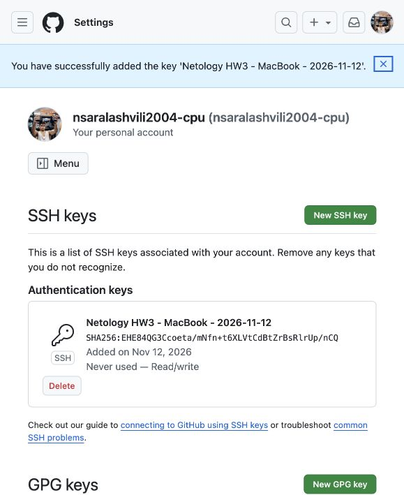

# SSH-доступ к GitHub

Саралашвили Никита Сергеевич. Программная инженерия, домашнее задание 3.

Репозиторий: https://github.com/nsaralashvili2004-cpu/netology-ssh-homework-3

## 1. SSH-клиент и генерация ключей

На macOS проверено наличие SSH-клиента командой `ssh -V`. Результат: OpenSSH_9.9p2, LibreSSL 3.3.6. Дополнительная установка не потребовалась.

Создана новая пара ключей Ed25519:

```bash
ssh-keygen -t ed25519 -a 64 -f ~/.ssh/id_ed25519_netology_hw3 -C netology-ssh-hw3-2026-11-02
```

При генерации введена непустая парольная фраза. Для учебного ключа выбрано отдельное имя; публичная часть сохранена в `~/.ssh/id_ed25519_netology_hw3.pub`. Приватная часть остаётся на компьютере.

Отпечаток публичного ключа:

```text
SHA256:EHE84QG3Ccoeta/mNfn+t6XLVtCdBtZrBsRlrUp/nCQ
```

Ключ загружен в агент на четыре часа:

```bash
ssh-add -t 14400 ~/.ssh/id_ed25519_netology_hw3
ssh-add -l
```

Проверка открытия приватного ключа с пустой фразой завершилась отказом: `incorrect passphrase supplied to decrypt private key`. Это подтверждает наличие защиты.

Подтверждения: [создание и загрузка ключа](evidence/key-generated.png), [клиент](evidence/ssh-client.txt), [отпечаток](evidence/key-fingerprint.txt), [SSH-agent](evidence/ssh-agent.txt), [проверка защиты](evidence/passphrase-check.txt).

## 2. Добавление публичного ключа в GitHub

В Settings → SSH and GPG keys добавлен публичный ключ типа Authentication Key с названием `Netology HW3 - MacBook - 2026-11-12`. Отпечаток в GitHub совпадает с локальным. GitHub подтвердил добавление ключа.



Приватный ключ и парольная фраза в репозиторий не загружаются.

## 3. Проверка SSH-подключения

Выполнена проверка подключения к `git@github.com` с явным выбором учебного ключа:

```bash
ssh -T -i ~/.ssh/id_ed25519_netology_hw3 \
  -o IdentitiesOnly=yes -o BatchMode=yes \
  -o StrictHostKeyChecking=yes \
  -o UserKnownHostsFile=./evidence/github_known_hosts git@github.com
```

Файл `github_known_hosts` содержит ключ сервера GitHub, сверенный с [официальной документацией](https://docs.github.com/en/authentication/keeping-your-account-and-data-secure/githubs-ssh-key-fingerprints). Его копия находится в каталоге evidence. При фактической проверке использован абсолютный путь к этому файлу.

Получен ответ:

```text
Hi nsaralashvili2004-cpu! You've successfully authenticated, but GitHub does not provide shell access.
```

Сообщение подтверждает успешную аутентификацию. Код завершения 1 здесь связан с отсутствием интерактивной оболочки GitHub. Режим BatchMode запрещает запрос пароля, поэтому успешное подключение подтверждает работу ключа, загруженного в агент.

Полный результат: [ssh-test.txt](evidence/ssh-test.txt).

## 4. Работа с репозиторием по SSH

Репозиторий клонирован по SSH-адресу:

```bash
git clone git@github.com:nsaralashvili2004-cpu/netology-ssh-homework-3.git
cd netology-ssh-homework-3
```

Перед командой установлен `GIT_SSH_COMMAND` с теми же параметрами ключа и проверки сервера, что в разделе 3. Затем создан файл `ssh_check.txt`, добавлены отчёт и подтверждения, создан коммит:

```bash
git add README.md .gitignore ssh_check.txt evidence
git commit -m "Complete SSH access practical cases"
git push origin main
```

Вывод клонирования: [clone.txt](evidence/clone.txt). Коммит `66dca02` успешно отправлен в ветку main. Подтверждения: [commit.txt](evidence/commit.txt), [push.txt](evidence/push.txt), [SSH-адрес origin](evidence/remote.txt). Запрос пароля был отключён параметром BatchMode=yes.

## Соответствие заданию

| Кейс | Подтверждение |
|---|---|
| Клиент и защищённая ключевая пара | ssh-client.txt, key-fingerprint.txt, passphrase-check.txt, key-generated.png |
| Публичный ключ в GitHub | github-key-added.png |
| Подключение к GitHub | ssh-test.txt |
| Клонирование, коммит и push | clone.txt, commit.txt, push.txt, remote.txt |

## Вывод

Настроена аутентификация по ключу Ed25519 с защитой парольной фразой. SSH-agent позволяет выполнять Git-операции без повторного ввода фразы в пределах срока загрузки ключа. Проверены добавление ключа, подключение к GitHub, клонирование репозитория и отправка коммита по SSH. Все четыре практических кейса выполнены.
